# Laboratorio: SAST local y pipeline CI con Bearer CLI

**Universidad Galileo — Curso de Ciberseguridad — PDSS**

- **Estudiante:** MasterJD
- **Carné:** 17001625
- **Repositorio:** `https://github.com/MasterJD/Laboratorio-SAST_17001625` (se mantiene este nombre; `juice-shop-sast` es el nombre sugerido en el enunciado)
- **Pull Requests de la Parte D:** [PR #1](https://github.com/MasterJD/Laboratorio-SAST_17001625/pull/1) (primer intento, fusionado), [PR #2](https://github.com/MasterJD/Laboratorio-SAST_17001625/pull/2) (corrección, fusionado) y [PR #3](https://github.com/MasterJD/Laboratorio-SAST_17001625/pull/3) (demostración de la alerta en la línea, abierto)
- **Fecha:** 22 de octubre de 2026

---

## Parte A — Repositorio propio

Se clonó OWASP Juice Shop, se eliminaron la carpeta `.git` original y la carpeta `.github/workflows`, y se inicializó un repositorio nuevo con el código en la raíz.

```powershell
git clone https://github.com/juice-shop/juice-shop.git
# Se eliminaron .git y .github/workflows del clon original
git init
git add .
git commit -s -m "Initial commit: OWASP Juice Shop para laboratorio SAST"
git remote add origin https://github.com/MasterJD/Laboratorio-SAST_17001625.git
git push -u origin main
```

Como se usa **GitHub Desktop**, el push se puede hacer desde la interfaz:

1. `File > Add local repository...` y seleccionar `D:\PERSONAL_FILES\UNIVERSIDAD\2026\Ciberseguridad\Laboratorio-SAST_17001625`.
2. Cambiar a la rama `main` y usar `Publish branch` o `Push origin`.
3. Cambiar a la rama `demo-vulnerabilidad` y volver a usar `Publish branch`.

Se agregaron al `.gitignore` los reportes locales:

```gitignore
# SAST reports (local / CI artifacts)
reports/
*.sarif
```

Los dos reportes HTML (`reports/bearer-report.html` y `reports/bearer-report-critical-high.html`) se agregaron con `git add -f` para que queden versionados en el repositorio; la regla `reports/` sigue evitando subir los JSON y SARIF locales.

---

## Parte B — Análisis local con Bearer CLI

Se utilizó **Docker Desktop** en lugar de WSL, que es una alternativa permitida por el laboratorio. La imagen utilizada fue `bearer/bearer:latest-amd64`.

### Comandos ejecutados

```powershell
# Reporte HTML completo, excluyendo pruebas y recursos que no son código de la aplicación
docker run --rm -v "${PWD}:/tmp/scan" bearer/bearer:latest-amd64 scan /tmp/scan `
  --format html --output /tmp/scan/reports/bearer-report.html `
  --skip-path "test,cypress,data/static,i18n,frontend/src/assets" `
  --exit-code 0 --hide-progress-bar

# Reporte SARIF
docker run --rm -v "${PWD}:/tmp/scan" bearer/bearer:latest-amd64 scan /tmp/scan `
  --format sarif --output /tmp/scan/reports/bearer-report.sarif `
  --skip-path "test,cypress,data/static,i18n,frontend/src/assets" `
  --exit-code 0 --hide-progress-bar

# Reporte JSON (para obtener severidad, CWE y fingerprint)
docker run --rm -v "${PWD}:/tmp/scan" bearer/bearer:latest-amd64 scan /tmp/scan `
  --format json --output /tmp/scan/reports/bearer-report.json `
  --skip-path "test,cypress,data/static,i18n,frontend/src/assets" `
  --exit-code 0 --hide-progress-bar

# Reporte HTML filtrado solo a severidades critical y high
docker run --rm -v "${PWD}:/tmp/scan" bearer/bearer:latest-amd64 scan /tmp/scan `
  --format html --output /tmp/scan/reports/bearer-report-critical-high.html `
  --severity critical,high `
  --skip-path "test,cypress,data/static,i18n,frontend/src/assets" `
  --exit-code 0 --hide-progress-bar
```

### Resumen del análisis

| Severidad | Hallazgos |
|---|---:|
| Crítica | 12 |
| Alta | 20 |
| Media | 20 |
| Baja | 281 |
| **Total** | **333** |

> El conteo inicial fue 333. Después de documentar el falso positivo en `bearer.ignore`, `main` queda en 332 (se descuenta 1 hallazgo medio). La rama `demo-vulnerabilidad` suma 1 crítico nuevo (`eval`), por lo que su escaneo vuelve a dar 333; al aplicar la corrección regresa a 332.

### Tabla de los 5 hallazgos más importantes

| # | Regla / ID | Severidad | CWE | Archivo:línea | ¿Verdadero o falso positivo? | ¿Por qué? |
|---:|---|---|---|---|---|---|
| 1 | `javascript_lang_sql_injection` | Crítica | CWE-89 | `routes/login.ts:34` | Verdadero positivo | Concatena el correo y el hash de la contraseña directamente en la consulta SQL. Permite inyección y bypass de autenticación. |
| 2 | `javascript_lang_sql_injection` | Crítica | CWE-89 | `routes/search.ts:23` | Verdadero positivo | Concatena `req.query.q` dentro de un `LIKE`. Permite inyección SQL tipo `UNION` y extracción de datos. |
| 3 | `javascript_lang_eval_user_input` | Crítica | CWE-95 | `routes/b2bOrder.ts:23` | Verdadero positivo | Ejecuta `orderLinesData` del cuerpo de la petición dentro de `vm.runInContext`. Es la base del reto de RCE de Juice Shop; aunque usa `notevil` y timeout, no valida la entrada. |
| 4 | `javascript_express_hardcoded_secret` | Crítica | CWE-798 | `lib/insecurity.ts:54` | Verdadero positivo | Firma los JWT con una clave privada embebida en el código. Cualquiera con acceso al repositorio puede forjar tokens. En Juice Shop es intencional; en producción sería crítico. |
| 5 | `javascript_express_server_side_request_forgery` | Alta | CWE-918 | `routes/profileImageUrlUpload.ts:24` | Verdadero positivo | Hace `fetch(url)` con una URL controlada por el usuario sin validar el destino. Permite SSRF hacia servicios internos. |

> Nota: Juice Shop es una aplicación deliberadamente vulnerable. Varios de estos hallazgos son intencionales y forman parte de sus retos; el análisis demuestra que Bearer los detecta correctamente.

### Evidencias

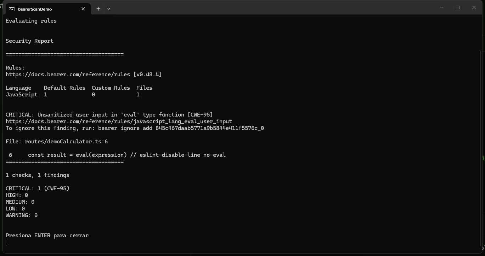

*Figura B1. Ejecución local de Bearer en Docker desde la terminal: detección del `eval` en `routes/demoCalculator.ts:6` (CWE-95, commit vulnerable `964751a`).*

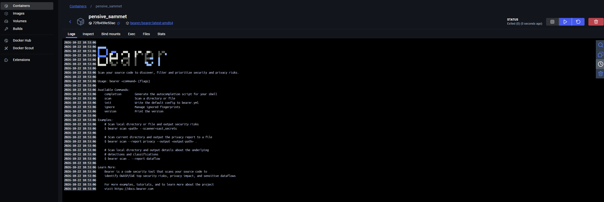

*Figura B2. Contenedor `pensive_sammet` con la imagen `bearer/bearer:latest-amd64`; el CLI de Bearer responde y muestra sus comandos disponibles.*

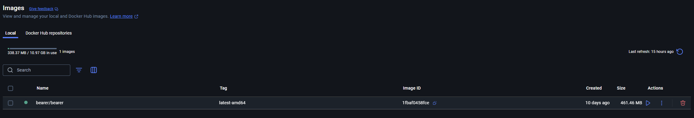

*Figura B3. Imagen local `bearer/bearer:latest-amd64` (461.46 MB) usada para ejecutar el análisis.*

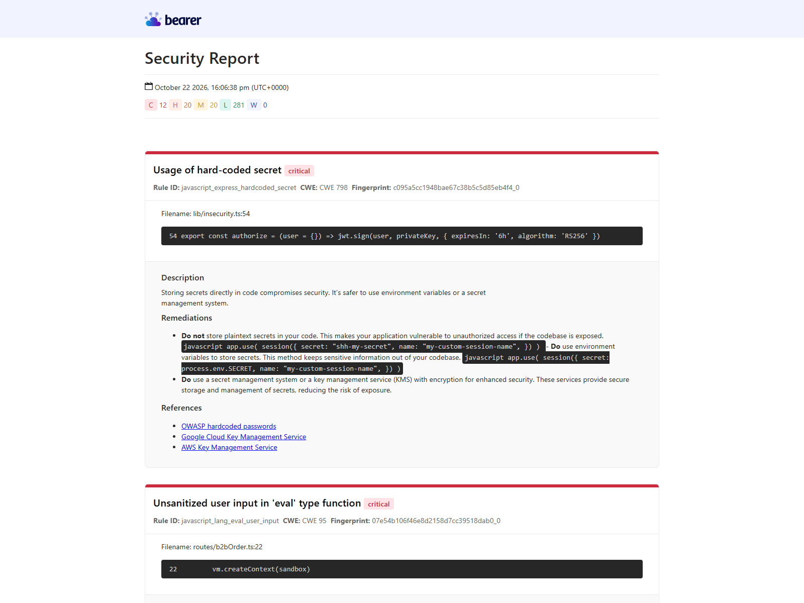

*Figura B4. Reporte HTML generado por Bearer: 12 críticos, 20 altos, 20 medios y 281 bajos (333 hallazgos iniciales).*

- Reporte SARIF generado: `reports/bearer-report.sarif` (archivo de datos, no captura).
- Reporte HTML filtrado a severidades `critical,high`: `reports/bearer-report-critical-high.html` (32 hallazgos).

---

## Parte C — Pipeline de GitHub Actions

Archivo: `.github/workflows/sast-bearer.yml`

El workflow cumple con los requisitos del laboratorio:

| # | Requisito | Implementación |
|---:|---|---|
| 1 | Push a `main`, pull request hacia `main` y ejecución manual | Bloque `on:` con `push`, `pull_request` y `workflow_dispatch`. |
| 2 | Permisos mínimos | `permissions: contents: read` y `security-events: write`. |
| 3 | Descargar el código y ejecutar Bearer sobre todo el repositorio | `actions/checkout@v4` y `bearer/bearer-action@v2` con `path: .`. |
| 4 | Generar SARIF y subirlo a Security > Code scanning | `format: sarif`, `output: results.sarif` y `github/codeql-action/upload-sarif@v3`. |
| 5 | Generar HTML y guardarlo como artefacto descargable | Segundo paso de Bearer con `format: html` y `actions/upload-artifact@v4`. |
| 6 | Subir resultados aunque Bearer encuentre vulnerabilidades | Los pasos de carga usan `if: always()`. El paso de Bearer usa `exit-code: 1`, pero la carga no se omite. |
| 7 | Cada línea del YAML lleva un comentario | Todas las líneas del archivo tienen un comentario explicativo. |

**Funcionamiento del control de fallos:** Bearer devuelve un código de salida distinto de cero cuando encuentra hallazgos. El paso `Ejecutar Bearer y generar SARIF` usa `exit-code: 1`, por lo que el job queda marcado como fallido. Los pasos de carga usan `if: always()` para ejecutarse de todos modos. El último paso (`steps.bearer_sarif.outcome == 'failure'`) es una salvaguarda redundante; en la ejecución real quedó omitido porque el job ya estaba fallido, pero el check sigue reflejando el resultado del análisis gracias al `exit-code` del paso de Bearer.

**Evidencia de ejecución en `main`:** `https://github.com/MasterJD/Laboratorio-SAST_17001625/actions/runs/39817027182` (merge commit `2acc782`). El job falla por los hallazgos existentes de Juice Shop, pero el paso `Subir SARIF a Code Scanning` termina en `success` y el artefacto `bearer-html-report` se publica igualmente (`if: always()`).

**Manejo del SARIF vacío:** cuando el escaneo diferencial no encuentra hallazgos, Bearer genera `results: null`. `upload-sarif` rechaza ese archivo con `instance.runs[0].results is not of a type(s) array`. El workflow agrega un paso con `jq` que convierte `null` en `[]` antes de subir el SARIF. También se exige que el archivo exista antes de intentar la carga.

**Escaneo diferencial en pull requests:** en eventos `pull_request`, el workflow activa `diff: true`, de modo que Bearer informa únicamente los hallazgos nuevos respecto a `main`. Esto es importante porque Juice Shop ya contiene cientos de hallazgos intencionales en `main`; sin el modo diferencial, el PR de la Parte D nunca podría pasar aunque se corrigiera la vulnerabilidad nueva. En `push` a `main` y en `workflow_dispatch` se ejecuta el escaneo completo.

### Evidencias

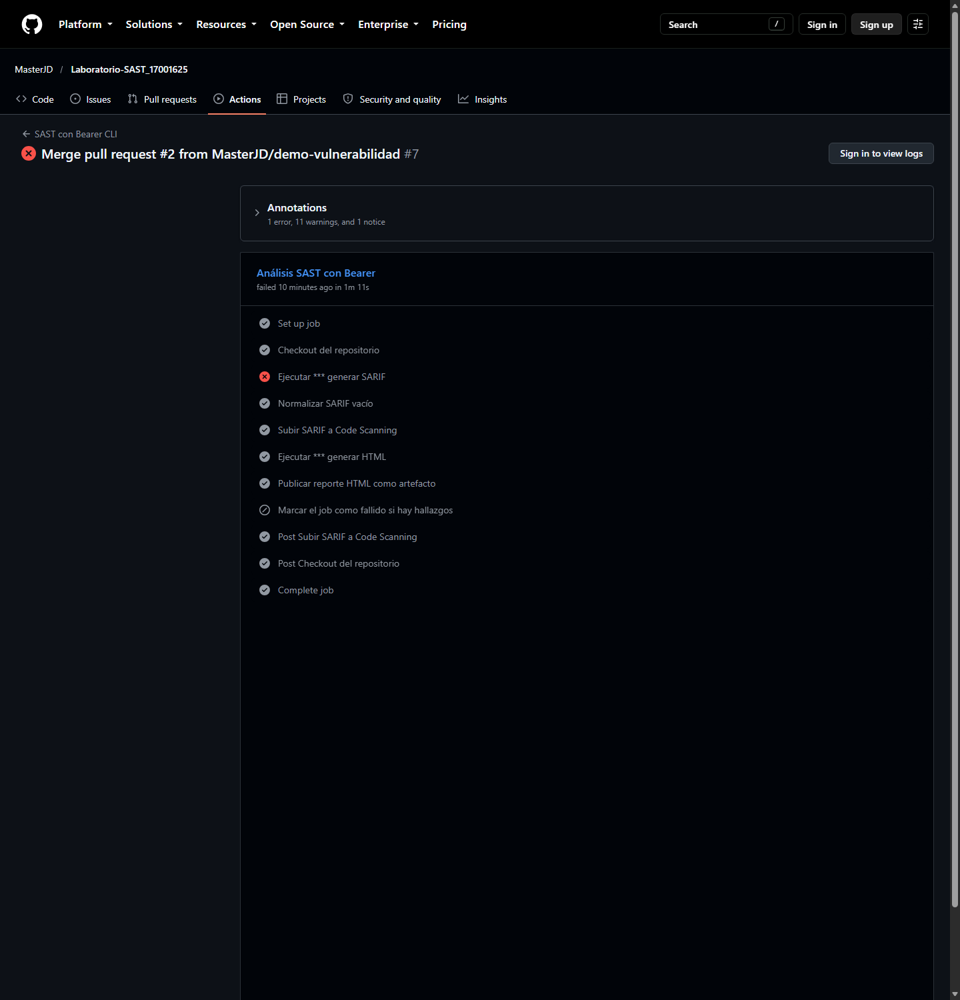

*Figura C1. Última ejecución `#7` del workflow sobre `main` (merge commit `ece6143`, tras el PR #2): el paso de Bearer falla por los 332 hallazgos preexistentes, pero los pasos de normalización, subida del SARIF y publicación del HTML terminan en `success`.*

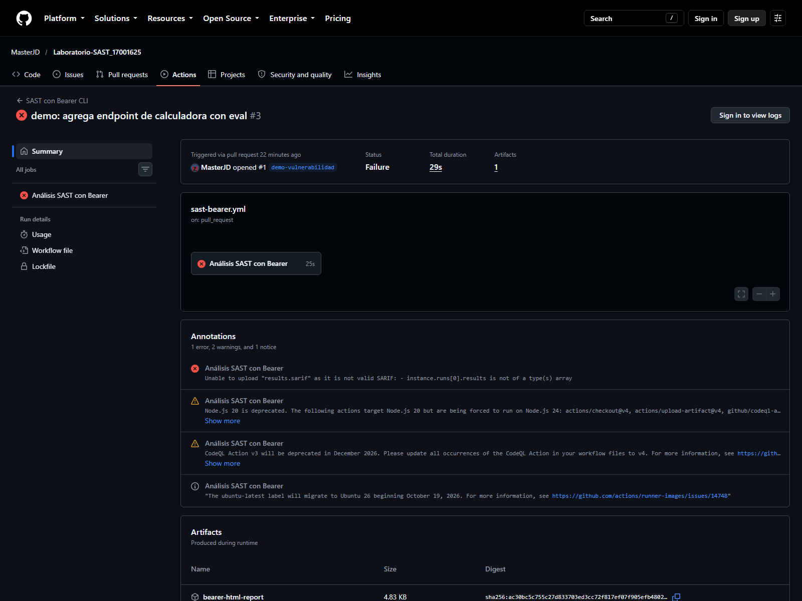

*Figura C2. Ejecución histórica `#3` del workflow sobre el PR #1. El escaneo diferencial quedó vacío porque la rama por defecto era `demo-vulnerabilidad`; el SARIF vacío no pudo subirse. Este fallo motivó la corrección del workflow y se conserva como evidencia del problema; la ejecución corregida del PR #2 se muestra en la Figura D2. La rama por defecto se cambió a `main` para que los PR posteriores usaran el diff correcto.*

- Ejecución completa en `main` (detección inicial): `https://github.com/MasterJD/Laboratorio-SAST_17001625/actions/runs/39817027182`
- Última ejecución en `main` (post PR #2): `https://github.com/MasterJD/Laboratorio-SAST_17001625/actions/runs/39823145082`
- Ejecución del PR #1: `https://github.com/MasterJD/Laboratorio-SAST_17001625/actions/runs/39817000729`
- Ejecución del PR #2: `https://github.com/MasterJD/Laboratorio-SAST_17001625/actions/runs/39823121552`
- Captura de Security > Code scanning: pendiente en `evidence/07-code-scanning-alerta.png`.

---

## Parte D — Ciclo cambio → detección → corrección

### 1. Rama y versión vulnerable

```powershell
git checkout -b demo-vulnerabilidad
```

Archivo agregado: `routes/demoCalculator.ts`

```ts
import { type Request, type Response } from 'express'

export function demoCalculator () {
  return (req: Request, res: Response) => {
    const expression = String(req.query.expression ?? '')
    const result = eval(expression) // eslint-disable-line no-eval
    res.json({ result })
  }
}
```

### 2. Detección local

```powershell
docker run --rm -w /tmp/scan -v "${PWD}:/tmp/scan" bearer/bearer:latest-amd64 scan routes/demoCalculator.ts `
  --format json --only-rule javascript_lang_eval_user_input --exit-code 0 --hide-progress-bar
```

Resultado local (también se confirmó con un escaneo completo de la rama):

```json
{
  "critical": [
    {
      "id": "javascript_lang_eval_user_input",
      "full_filename": "routes/demoCalculator.ts",
      "line_number": 6,
      "fingerprint": "f530593303718d2f25fd6186f459db00_0"
    }
  ]
}
```

### 3. Commit vulnerable y Pull Request

El commit vulnerable está etiquetado como `demo-vulnerable` (`964751a`). El PR #1 se abrió desde `demo-vulnerabilidad` hacia `main` y se fusionó el 22/10/2026 a las 16:47:58; el merge commit es `2acc782`.

Estado actual:

- `main` contiene el endpoint corregido y el workflow actualizado.
- El PR #1 (detección) quedó fusionado; su ejecución (`https://github.com/MasterJD/Laboratorio-SAST_17001625/actions/runs/39817000729`) falló por el SARIF vacío del escaneo diferencial.
- La ejecución completa de `main` posterior al PR #1 (`https://github.com/MasterJD/Laboratorio-SAST_17001625/actions/runs/39817027182`) detectó el `eval` y subió el SARIF; la alerta quedó en Security > Code scanning.
- El PR #2 (corrección) se fusionó el 22/10/2026 a las 17:29:25; el merge commit es `ece6143`.
- El check `SAST con Bearer CLI` del PR #2 terminó en `success` (`https://github.com/MasterJD/Laboratorio-SAST_17001625/actions/runs/39823121552`, 41 s). La rama por defecto seguía siendo `demo-vulnerabilidad`, por lo que el diff pudo quedar vacío; la validación real del fix la aporta el escaneo completo de `main` posterior a la fusión (`https://github.com/MasterJD/Laboratorio-SAST_17001625/actions/runs/39823145082`), que ya no contiene el `eval`.
- Las ejecuciones de `main` posteriores al PR #2 (#7 con `ece6143`, #8 con `62e040b` y #11 con `4a33e90`) siguen fallando por los 332 hallazgos preexistentes de Juice Shop, pero suben el SARIF y el artefacto HTML correctamente. Ese fallo es esperado y no indica que la corrección haya fallado.
- El PR #3 de demostración (`demo-alerta`) reintrodujo el `eval` en `2b0fe13`; el check falló con **1 new alert** anotada en la línea 6 (Figura D4). El commit `59116f1` restauró la versión segura; la ejecución #10 (`39898670249`) terminó en `success` en 25 s y sin anotaciones (Figura D6). El PR queda abierto como demostración y muestra `Files changed 0`, porque el árbol vuelve a ser el de `main`.

> **Lección aprendida:** el action de Bearer usa `github.event.repository.default_branch` como base del diff. Si la rama por defecto es `demo-vulnerabilidad`, un PR desde esa misma rama produce un diff vacío. Por eso conviene que `main` sea la rama por defecto antes de abrir el PR de corrección. Además, Bearer genera `results: null` cuando no hay hallazgos; el workflow lo normaliza a `[]` para que `upload-sarif` no falle.

Ciclo completado:

1. PR #1: detección del `eval` y alerta en `main`.
2. PR #2: corrección, check en verde y fusión.
3. `main`: escaneo completo sin el `eval`; GitHub cierra la alerta al desaparecer el hallazgo del análisis.
4. Rama por defecto: se cambió a `main`; el PR #3 confirmó el diff con la anotación en la línea 6 y el check verde tras la corrección.

### 4. Corrección

Después de observar la alerta en el PR, se reemplaza `eval` por una lista blanca de operaciones y operandos numéricos. El commit de corrección `ef09119` (tag `demo-corregido`) se fusionó en `main` mediante el PR #2 (`ece6143`):

```ts
import { type Request, type Response } from 'express'

export function demoCalculator () {
  return (req: Request, res: Response) => {
    const a = Number(req.query.a)
    const b = Number(req.query.b)
    const op = String(req.query.op ?? '')
    if (!Number.isFinite(a) || !Number.isFinite(b)) {
      return res.status(400).json({ error: 'Operandos inválidos' })
    }
    let result: number
    switch (op) {
      case '+': result = a + b; break
      case '-': result = a - b; break
      case '*': result = a * b; break
      case '/': result = b === 0 ? NaN : a / b; break
      default: return res.status(400).json({ error: 'Operador no permitido' })
    }
    res.json({ result })
  }
}
```

```powershell
git add routes/demoCalculator.ts
git commit -s -m "fix: reemplaza eval por operaciones permitidas"
git push
```

Con GitHub Desktop, el segundo commit se sube con `Push origin` sobre la misma rama `demo-vulnerabilidad`.

Resultado local después de la corrección:

```text
0 hallazgos para javascript_lang_eval_user_input
```

Tras fusionar el PR #2, el análisis completo de `main` ya no reporta el `eval`, por lo que GitHub cierra la alerta de la versión vulnerable.

Para que la evidencia del PR con la alerta sobre la línea no dependiera del intento fallido del PR #1, se creó la PR de demostración #3 (`demo-alerta`) desde `main` y con el workflow ya corregido. El commit `2b0fe13` reintroduce el `eval`; el check `Bearer` falla y reporta **1 new alert** anotada en `routes/demoCalculator.ts:6` (Figuras D4 y D5). El commit `59116f1` restaura la versión segura; la ejecución #10 (`39898670249`) terminó en `success` en 25 s y sin anotaciones (Figura D6). La corrección definitiva ya está fusionada en `main` mediante el PR #2, por lo que la PR #3 es solo la demostración del ciclo detección → corrección y su `Files changed` queda en 0.

### Evidencias

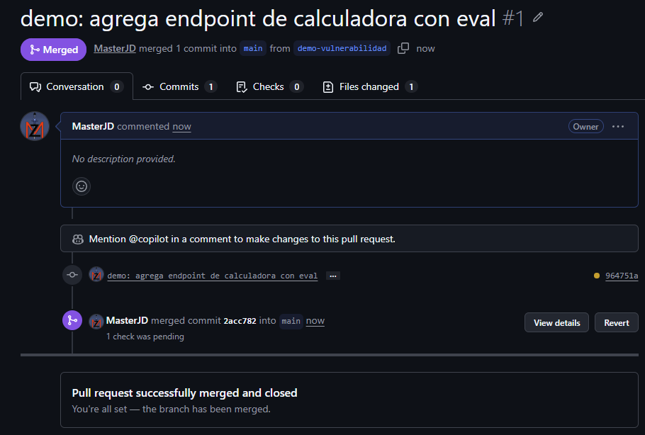

*Figura D1. PR #1 (`demo: agrega endpoint de calculadora con eval`), fusionado en `main` con el commit `2acc782`.*

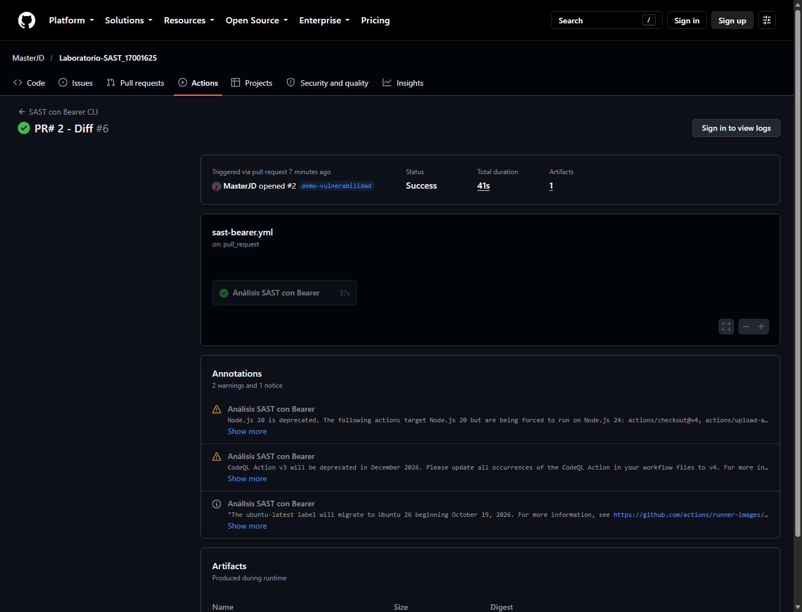

*Figura D2. PR #2 fusionado (`ece6143`); la ejecución `#6` del check `SAST con Bearer CLI` terminó en `success` (`39823121552`).*

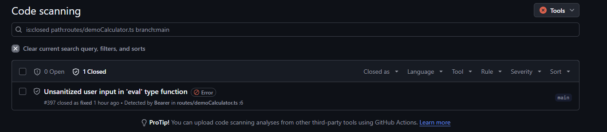

*Figura D3. Alerta #397 (`javascript_lang_eval_user_input` en `routes/demoCalculator.ts:6`) cerrada como fixed después de la corrección.*

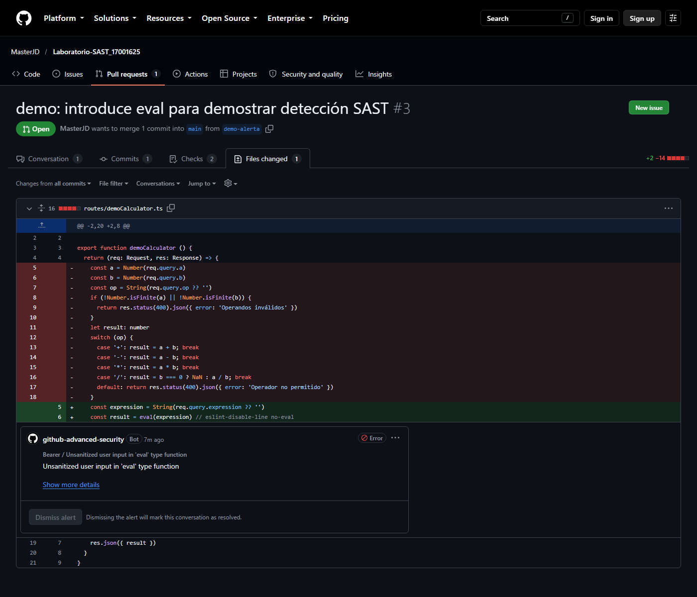

*Figura D4. PR #3 (`demo-alerta`, commit `2b0fe13`): en `Files changed` se ve el `eval` en la línea 6 de `routes/demoCalculator.ts` y la anotación de Code Scanning "Unsanitized user input in 'eval' type function".*

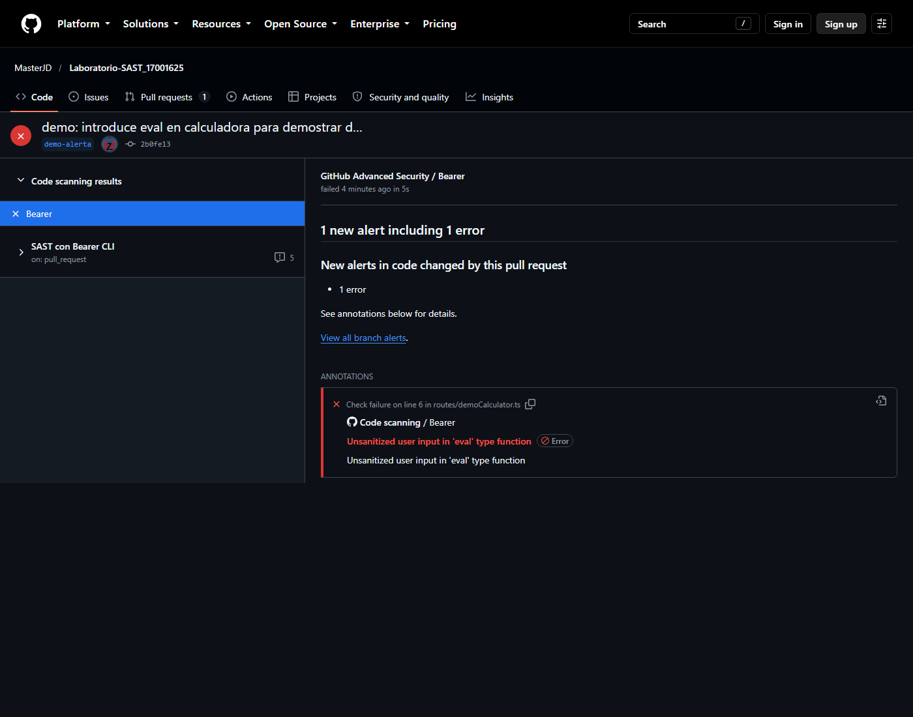

*Figura D5. Resumen del check `Bearer`: "1 new alert including 1 error" en el código cambiado por el PR #3.*

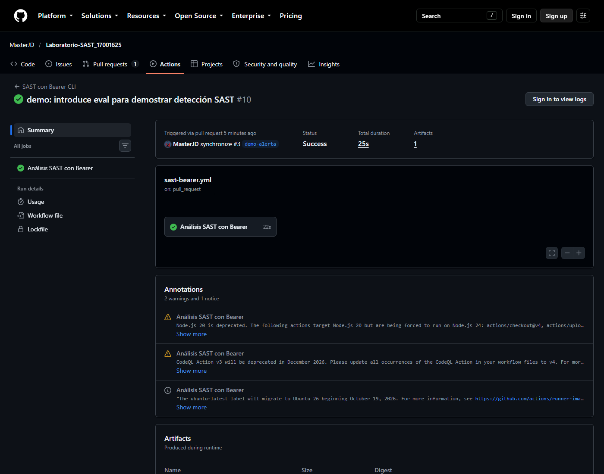

*Figura D6. PR #3: la ejecución #10 (`39898670249`) sobre el commit de corrección `59116f1` terminó en `success` (25 s); el check `Bearer` quedó sin anotaciones.*

- Captura del detalle de la alerta en Security > Code scanning: pendiente en `evidence/07-code-scanning-alerta.png`.

---

## Parte E — Preguntas de análisis

### 14. ¿Qué diferencias encontraste entre el análisis local y el del pipeline? ¿Por qué conviene tener los dos?

El análisis local es inmediato y permite experimentar con opciones, rutas, severidades y reglas antes de subir cambios. También sirve para revisar el código con calma y entender los hallazgos. El pipeline, en cambio, se ejecuta siempre en un entorno limpio y reproducible, sobre cada push y cada pull request, y deja evidencia centralizada en GitHub Actions y en Code Scanning.

Conviene tener los dos porque se complementan: el local da retroalimentación temprana al desarrollador (shift-left) y el pipeline actúa como control obligatorio que no depende de que alguien recuerde ejecutar la herramienta. Además, el pipeline conserva historial, aplica los mismos permisos y puede bloquear la integración de cambios inseguros.

### 15. ¿Qué ventajas y limitaciones tiene SAST frente a DAST?

**Ventajas de SAST:** analiza el código sin ejecutar la aplicación, detecta problemas en etapas tempranas, cubre rutas y archivos que quizá no se ejercitan en pruebas manuales, y señala la línea exacta del código. Es útil para inyectar seguridad en el ciclo de desarrollo y para revisar cambios en pull requests.

**Limitaciones de SAST:** puede producir falsos positivos porque no conoce el contexto de ejecución, la configuración real ni los controles externos; depende del lenguaje y de las reglas disponibles; y no siempre demuestra que la vulnerabilidad sea explotable.

**Ventajas de DAST:** prueba la aplicación en ejecución, por lo que valida la explotabilidad real, incluye configuración del servidor, autenticación, sesiones y problemas que solo aparecen en tiempo de ejecución.

**Limitaciones de DAST:** requiere una aplicación desplegada y accesible, llega más tarde en el ciclo, puede no cubrir todas las rutas y estados, y no siempre indica la línea de código que originó el problema.

La conclusión es que SAST y DAST no son excluyentes: SAST ayuda a prevenir y DAST ayuda a validar.

### 16. ¿Bloquearías el merge de un PR si el SAST encuentra hallazgos? ¿Con qué criterio (severidad, tipo)?

Sí, bloquearía el merge para hallazgos **críticos y altos confirmados** que afecten código de producción y sean explotables. Para hallazgos medios, permitiría el merge con revisión y un plazo de corrección; para los bajos, no bloquearía, pero los registraría.

El criterio no debería ser solo la severidad. También consideraría: si el código está en una ruta realmente expuesta, si el dato llega desde el usuario, si existe una mitigación compensatoria, y si el hallazgo fue revisado y marcado como falso positivo. Además, usaría protección de rama para exigir que el check de SAST esté en verde, y un proceso documentado de excepciones con justificación y fecha de revisión.

### 17. Elige un hallazgo que consideres falso positivo y explica cómo lo gestionarías en Bearer sin desactivar la regla para todo el proyecto.

Elegiría el hallazgo `javascript_lang_observable_timing` en `routes/login.ts:37`:

```ts
if (user.data?.id && user.data.totpSecret !== '') {
```

Bearer lo marca como una posible discrepancia de tiempo al comparar un secreto. En realidad, esa comparación solo comprueba si el usuario tiene configurado un segundo factor (`totpSecret !== ''`); no está validando el valor del secreto ni comparándolo con una entrada del atacante. Por eso lo considero un falso positivo en este contexto.

Para gestionarlo sin desactivar la regla globalmente, usaría el fingerprint del hallazgo y el archivo `bearer.ignore`:

```powershell
bearer ignore add d1bc10543b48b63f88106e770ff22029_0 `
  --false-positive `
  --author MasterJD `
  --comment "Solo verifica si el 2FA está configurado; no compara un secreto"
```

Esto genera una entrada en `bearer.ignore` asociada al hallazgo concreto (archivo, línea y huella), no a la regla completa. El archivo se versiona en el repositorio y Bearer lo lee tanto en local como en el pipeline. Así se documenta la decisión, se mantiene la regla activa para el resto del proyecto y se evita que el mismo falso positivo vuelva a aparecer en cada ejecución.

---

## Checklist de capturas para el PDF

- [x] Ejecución local de Bearer en la terminal: `evidence/10_terminal_bearer.png`.
- [x] Bearer ejecutándose en Docker: `evidence/02_Docker_Bearer.png` y `evidence/03_Docker_Bearer.png`.
- [x] Reporte HTML abierto en el navegador: `evidence/04_reporte_HTML.png`.
- [x] Workflow en Actions (fallo esperado en `main`, fallo con alerta en el PR #3 y éxito en el PR #2): `evidence/05_actions_main.png`, `evidence/06_actions_pr1.png`, `evidence/08-pr2-check-verde.png` y `evidence/11_pr_alerta_linea.png`.
- [x] Pull Request #1: `evidence/01_PR.png`.
- [x] PR #3 con la alerta de Bearer sobre `routes/demoCalculator.ts:6`: `evidence/12_pr_files_alerta.png` y resumen del check en `evidence/11_pr_alerta_linea.png`.
- [x] Check verde del PR #3 tras la corrección: `evidence/14_pr3_run_verde.png` (run #10, `39898670249`) y `evidence/13_pr3_checks_verde.png`.
- [x] Pull Request #2 con el check en verde: `evidence/08-pr2-check-verde.png`.
- [x] Alerta #397 cerrada como fixed: `evidence/09-code-scanning-cerrada.png` (lista filtrada; el commit de cierre `ece6143` se documenta en el texto).
- [x] Reporte HTML dentro del repositorio: `reports/bearer-report.html` y `reports/bearer-report-critical-high.html` (agregados con `git add -f`).
- [x] Nombre del repositorio: se mantiene `Laboratorio-SAST_17001625` por decisión del autor; `juice-shop-sast` queda como nombre sugerido en el enunciado.
- [ ] Detalle adicional de la alerta #397 en Security > Code scanning: `evidence/07-code-scanning-alerta.png` (la captura actual muestra la lista filtrada; la Figura D4 ya documenta la alerta con archivo y línea).

## Pendientes para la entrega

- [ ] PDF final con portada, tabla de hallazgos, pipeline, respuestas y capturas.
- [ ] Captura opcional del detalle de la alerta #397 (`evidence/07-code-scanning-alerta.png`).
